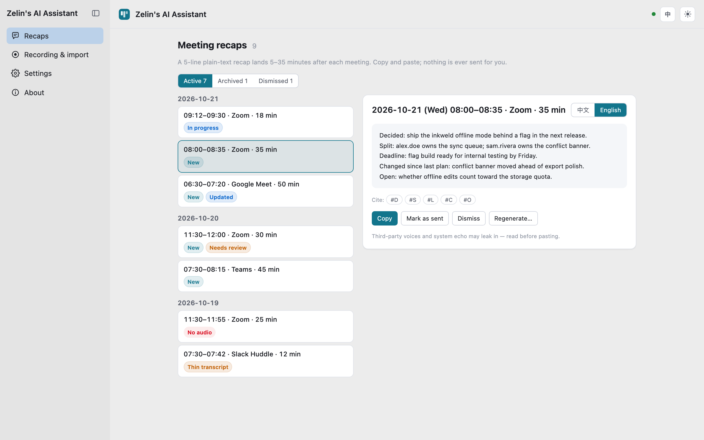
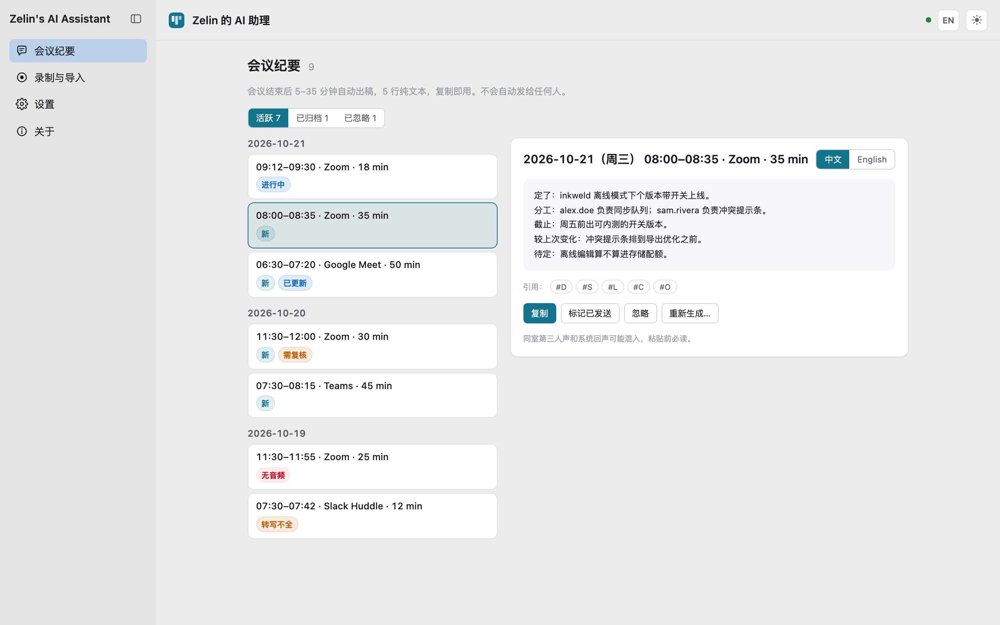
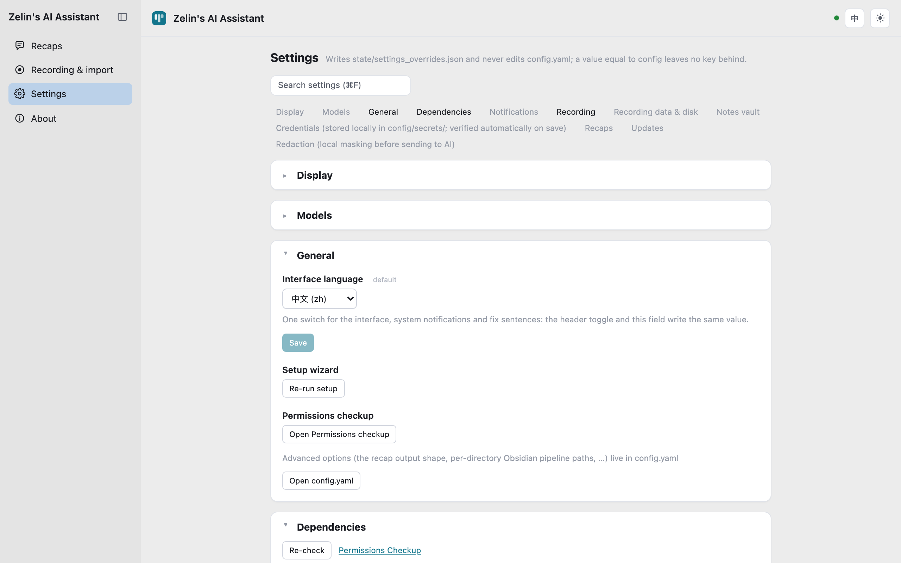
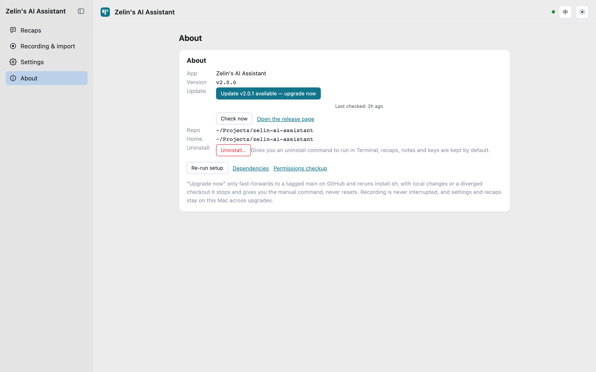
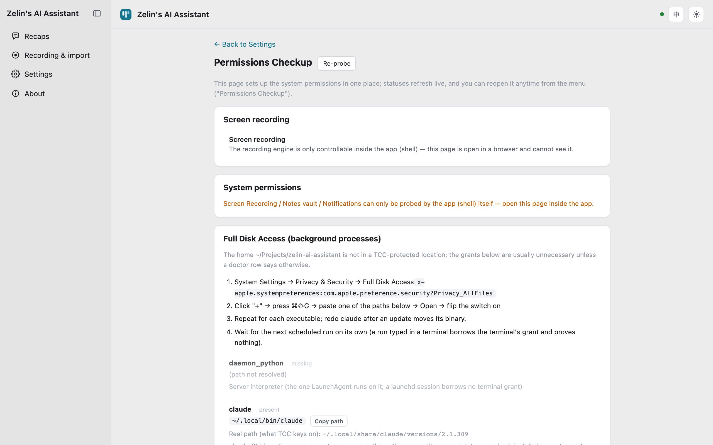

# Zelin's AI Assistant

**English** | [简体中文](README.zh-CN.md)

[](https://github.com/Wan-ZL/zelin-ai-assistant/actions/workflows/ci.yml)
[](https://github.com/Wan-ZL/zelin-ai-assistant/releases/latest)
[](LICENSE.md)
[](docs/INSTALL.md)
[](docs/INSTALL.md)

A small macOS assistant that records your screen and meetings locally, turns the recordings into Obsidian notes, and writes a short recap after each meeting. It is the lite 2.0 line of this project: four parts and nothing else.

- **Recording** — the [screenpipe](https://github.com/mediar-ai/screenpipe) engine captures screen text and audio on your Mac, hosted by the Dock app.
- **Obsidian ingest** — every 30 minutes one cron line exports what was captured and a headless Claude run files it into your Obsidian vault (`ingest/`).
- **Meeting recaps** — about 5 to 35 minutes after a meeting ends, `act/recap.py` writes a recap: five tagged lines (decided, owners, deadline, changed since last time, still open) or a longer version with sections. You copy it; nothing is ever sent for you.
- **A small Dock app** — a local web UI (`web/`, served by the stdlib server in `server/`) inside a thin Dock shell (`shell/`): the recaps page, recording and import, settings, about.

The version truth is the git tag on `main`; `python3 scripts/version_stamp.py` prints the version of the checkout in front of you.



<p align="center"><sub>Every screenshot on this page is a real render of the web UI from the fictional demo recaps in <code>scripts/demo_seed.py</code>, captured by <code>scripts/qa/readme_shots.mjs</code>. No real person, meeting or repository appears in them.</sub></p>

## Install

macOS 14+ only. You need the Xcode Command Line Tools, the [Claude Code CLI](https://claude.com/claude-code), Node.js LTS and an Anthropic API key.

```bash
git clone https://github.com/Wan-ZL/zelin-ai-assistant ~/Projects/zelin-ai-assistant
cd ~/Projects/zelin-ai-assistant
bash install.sh
```

`install.sh` creates `config.yaml` from `config.example.yaml` if it is missing, builds the web UI and the Dock app, loads one LaunchAgent for the local server, writes one cron line for the ingest chain, and ends with a diagnostics run. The same steps as one command on a blank Mac:

```bash
curl -fsSL https://raw.githubusercontent.com/Wan-ZL/zelin-ai-assistant/main/scripts/bootstrap.sh | bash
```

What is left for you: put your Anthropic API key in `config/secrets/anthropic-api-key.txt` (or paste it under Settings → Credentials), turn recording on in the app, and grant Full Disk Access where the diagnostics ask for it. `bash install.sh --check` lists anything still missing. [docs/INSTALL.md](docs/INSTALL.md) has every step with its expected result, and [docs/TROUBLESHOOTING.md](docs/TROUBLESHOOTING.md) the symptom-first fixes.

## Upgrade

- **In the app** — the About page checks GitHub at most once a day. When a release is out, click "Upgrade now".
- **From a terminal** — `bash scripts/upgrade.sh` does the same thing.

Both only fast-forward your checkout to the tagged `main` and rerun `install.sh`. With local changes or a diverged checkout they stop, change nothing, and print the command to run by hand. Recording is not interrupted, and your settings and recaps stay where they are. Automatic upgrades within the same major version are an opt-in switch in Settings; a new major version is always a manual step.

To remove everything the installer added: `bash uninstall.sh` (`--dry-run` shows the plan first).

## Privacy

- **Local only.** Recordings, notes and recaps stay on your Mac. The server listens on 127.0.0.1 only.
- **No telemetry.** The app uploads no usage statistics and no feedback. Content leaves the machine only as model calls to the Anthropic API with your key; the only other request is the daily version check against GitHub, which you can turn off.
- **Isolated Claude runs.** Every headless `claude -p` uses its own config directory under `~/Library/Application Support/ZelinAIAssistant/claude-config/`, an empty working directory outside the repository, and `--bare`. It does not load your Claude Code hooks, plugins, MCP servers or CLAUDE.md, writes no session history to your Claude Code directory, and never reads or writes `~/.claude`.
- **Sensitive apps are excluded** from capture at the engine level (`recording.ignored_apps` in `config.yaml`: password managers, Keychain Access and private browsing windows by default).

Every outbound channel, when it fires, what it carries and the switch that turns it off: [docs/PRIVACY.md](docs/PRIVACY.md). Report vulnerabilities privately via [SECURITY.md](SECURITY.md).

## The app

| | |
|---|---|
|  |  |
| Meeting recaps in 中文: each recap carries both languages, and one switch in the header changes the whole UI | Settings: one searchable page, folded by area |
|  |  |
| About: version, update check, the upgrade and the uninstall command | Permissions Checkup: what the app needs from macOS, with the exact paths |

To look at the UI without installing anything, run the demo: it seeds fictional recaps into a temporary directory and never touches a real `state/`.

```bash
bash scripts/dev-preview.sh
```

## Moving from 1.x

1.x and 2.0 cannot run side by side on one Mac. The 1.x line stops at a major-version boundary and does not upgrade itself into 2.0, so the move is one manual step, described in [docs/INSTALL.md](docs/INSTALL.md); `install.sh` removes the 1.x background agents and cron lines on the way.

The last full 1.x release is archived as the git tag and branch `full`. To go back to it:

```bash
git fetch --tags && git checkout full && bash install.sh
```

```removed
Removed in 2.0 (all of it is still in the tree at tag and branch full; last full 1.x release: v1.0.117)
- The Act pipeline: the Slack, Gmail, Obsidian and Claude-session radars, the requirement registry, approval cards and the kanban board, the actd daemon and its claude --bg agents, quick capture, the skills page and the recycle bin
- Live captions, recap-to-Slack drafts and the voice-profile injection into agent drafts
- Telemetry: anonymous usage events, the Supabase upload and the feedback channel
- The native Mac app (mac/), the iOS approver (ios/), the Linux and Windows installers, the .pkg installer, Sparkle updates and auto-deploy
```

## Requirements

| Component | Version | Used for |
|---|---|---|
| macOS | 14+ | the only supported platform |
| [Claude Code CLI](https://claude.com/claude-code) + Anthropic API key | latest | the headless ingest and recap runs |
| Python | 3.9+ with PyYAML | the server, the recap and the diagnostics (`/usr/bin/python3` is enough) |
| Node.js | LTS | building the web UI; the capture engine runs via `npx screenpipe` |
| Xcode Command Line Tools | — | git, and building the Dock app (`shell/`) |
| Obsidian *(recommended)* | — | where the ingest chain writes its notes |

## Contributing

The Python test suite runs with just Python and PyYAML, and `scripts/demo_seed.py` drives the whole UI with fictional data: no API key, no screenpipe, no Obsidian. Start with [CONTRIBUTING.md](CONTRIBUTING.md); the [CODE_OF_CONDUCT.md](CODE_OF_CONDUCT.md) applies everywhere. Release notes: [CHANGELOG.md](CHANGELOG.md) and the GitHub releases. What comes next: [docs/ROADMAP.md](docs/ROADMAP.md).

Questions → [Discussions (Q&A)](https://github.com/Wan-ZL/zelin-ai-assistant/discussions) · bugs → [issue forms](https://github.com/Wan-ZL/zelin-ai-assistant/issues/new/choose).

## License

Released under the [Functional Source License 1.1, MIT Future License (FSL-1.1-MIT)](LICENSE.md). In plain English:

- **You can** use, fork, modify and redistribute it, including commercial use inside your company.
- **You can't** sell a product or service that competes with this software.
- **Future open source**: each release converts to the MIT License two years after it ships.
- **Contributions** are welcome; see [CONTRIBUTING.md](CONTRIBUTING.md). (GitHub shows the license as "Other" because FSL is not in its detector; the badge above is authoritative.)

More questions are answered in [docs/LICENSE-FAQ.md](docs/LICENSE-FAQ.md).

## Documentation

| Doc | What's inside |
|---|---|
| [docs/INSTALL.md](docs/INSTALL.md) | install, upgrade, moving from 1.x and uninstall, step by step |
| [docs/PRIVACY.md](docs/PRIVACY.md) / [SECURITY.md](SECURITY.md) | every outbound channel and its switch / vulnerability reporting |
| [docs/TROUBLESHOOTING.md](docs/TROUBLESHOOTING.md) | symptom-first fixes |
| [docs/CONTRACT.md](docs/CONTRACT.md) | the behaviour contract; change it in the same PR as the behaviour |
| [HANDOFF.md](HANDOFF.md) | a short map of the system and the pitfalls already paid for |
| [docs/DEMO.md](docs/DEMO.md) | demo mode and how the screenshots are made |
| [docs/design/lite2-plan.md](docs/design/lite2-plan.md) | the lite 2.0 plan and its decision log |
| [docs/ROADMAP.md](docs/ROADMAP.md) | what is in progress and what comes next |
| [CONTRIBUTING.md](CONTRIBUTING.md) / [CODE_OF_CONDUCT.md](CODE_OF_CONDUCT.md) | how to contribute / community standards |
| [docs/LICENSE-FAQ.md](docs/LICENSE-FAQ.md) | FSL-1.1-MIT in practice |
| [docs/SANITIZATION.md](docs/SANITIZATION.md) | how this public export was sanitized from the private repo |

### Repository layout

```
ingest/                    # screenpipe → Obsidian chain (export / cleanup / process + skill)
act/recap.py               # meeting recaps (one isolated headless claude call per meeting)
act/doctor.py              # diagnostics (install.sh --check)
act/lib/                   # config / recap store / notify / secrets / isolation constants
server/                    # stdlib HTTP + SSE server on 127.0.0.1: recaps, settings, about, upgrade
web/                       # the React UI
shell/                     # the Dock app: hosts the recording engine, notifications
scripts/                   # bootstrap, upgrade, demo data, CI and quality gates
```

Every claim on this page is machine-checked: `python3 scripts/qa/readme_audit.py --summary` extracts each sentence, bullet, table row and command above and re-checks its paths, its retired-feature wording and its UI labels against the shipped code.

## Contributors

Thanks to everyone who has contributed:

[](https://github.com/Wan-ZL/zelin-ai-assistant/graphs/contributors)

Want to join them? Start with a [good first issue](https://github.com/Wan-ZL/zelin-ai-assistant/issues?q=is%3Aissue+is%3Aopen+label%3A%22good+first+issue%22) and see [CONTRIBUTING.md](CONTRIBUTING.md).

Copyright (c) 2026 Zelin Wan (https://github.com/Wan-ZL)
